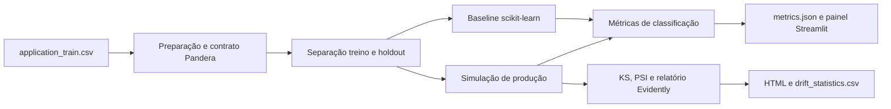
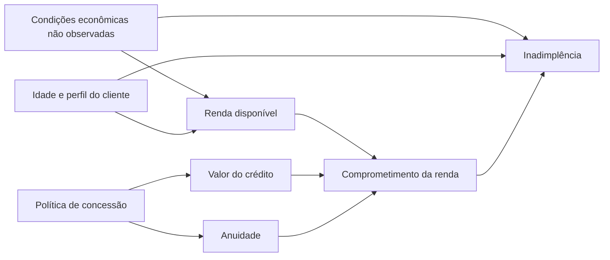

# Tech Challenge Fase 4 - Observabilidade de Credit Scoring

Este projeto acompanha um classificador simples de risco de crédito desde a validação dos dados até a análise de drift. A proposta é mostrar o que acontece quando o lote recebido deixa de se parecer com os dados usados no treino e como isso aparece nas métricas. Para os dados de referência usamos `application_train.csv`, da competição Home Credit Default Risk.

> **Uso acadêmico:** os dados de produção e a mudança de conceito são simulados. Este modelo não deve apoiar decisões reais de crédito.

## O que o projeto demonstra

- Baseline de classificação com Scikit-Learn.
- Contrato Pandera que bloqueia valores ausentes, idade fora do intervalo, valores monetários inválidos e campos fora do domínio.
- Separação entre população de referência e lote de produção simulado.
- Alteração controlada de renda, crédito e anuidade para simular data drift.
- Mudança da relação entre características e inadimplência para simular concept drift.
- Comparação estatística via Kolmogorov-Smirnov e PSI, além de relatório HTML do Evidently.
- Métricas de qualidade do modelo, volume, duração, status e eventos registrados em JSON.
- Painel Streamlit local para acompanhar resultados.
- Documentação de privacidade, limites de uso e governança.

## Stack

- Python 3.11 ou 3.12
- Pandas, NumPy, SciPy e Scikit-Learn
- Pandera para data contracts
- Evidently para relatório de drift
- Streamlit para o painel local
- Kaggle API para obter o arquivo oficial (requer aceite das regras da competição)

## Estrutura

```text
.
|-- data/raw/                 # arquivo do Kaggle, fora do Git
|-- data/processed/           # reservado para dados derivados, fora do Git
|-- data/artifacts/           # reservado para modelo serializado, fora do Git
|-- docs/                     # fonte de dados e governança
|-- logs/                     # eventos JSONL, fora do Git
|-- monitoring/               # painel Streamlit
|-- reports/generated/        # relatório HTML e métricas agregadas versionados
|-- scripts/                  # setup, download e execução no Windows
|-- src/credit_drift/         # pipeline, contrato, modelo e detecção
`-- pyproject.toml
```

## 1. Preparar o ambiente no Windows

Na raiz do projeto:

```powershell
.\scripts\setup_windows.ps1
```

O script cria `.venv` e instala as dependências do projeto, do painel e do cliente Kaggle. Se o PowerShell bloquear scripts nesta sessão, rode:

```powershell
Set-ExecutionPolicy -Scope Process -ExecutionPolicy Bypass
```

## 2. Obter o dataset

O arquivo usado é `application_train.csv`, da competição [Home Credit Default Risk no Kaggle](https://www.kaggle.com/competitions/home-credit-default-risk/data). É necessário entrar na conta Kaggle e aceitar as regras da competição antes do download. Siga o guia [docs/DATASET.md](docs/DATASET.md).

Com as credenciais da sua própria conta Kaggle configuradas:

```powershell
.\scripts\download_data.ps1
```

Também é possível baixar o arquivo pela interface web e salvá-lo em `data/raw/application_train.csv`. O arquivo bruto e as credenciais são ignorados pelo Git. Não os publique.

## Como o pipeline funciona



Usamos só a tabela principal do Home Credit para manter o experimento reproduzível sem agregar várias tabelas relacionadas. O conjunto original não representa uma sequência temporal de produção. Por isso, o pipeline separa um holdout aleatório e altera nele algumas distribuições e a regra que gera o resultado. O drift observado é intencional e serve para demonstrar o monitoramento.

### Análise causal do cenário

A hipótese de trabalho é que a capacidade de pagamento influencia a inadimplência. Renda, valor do crédito e anuidade são medidas relacionadas a essa capacidade, mas a relação também depende de fatores que não estão representados por completo neste recorte, como outras dívidas, despesas, estabilidade de emprego e condições econômicas.



O diagrama é uma hipótese causal para orientar a interpretação, não algo estimado pelo dataset. O arquivo usado é observacional e não contém uma série histórica de condições econômicas que permita isolar o efeito de uma crise. Além disso, o modelo usa um recorte de features e não inclui todas as variáveis do diagrama. Portanto, associações encontradas pelo classificador não demonstram que uma variável causou a inadimplência.

Na simulação, separamos dois tipos de mudança:

- **Data drift:** multiplicamos `AMT_INCOME_TOTAL` por `1.30`, `AMT_CREDIT` por `1.18` e `AMT_ANNUITY` por `1.12`. Essa intervenção muda as distribuições de entrada. Por si só, ela não prova que o risco aumentou; inclusive, essas proporções reduzem os valores de crédito e anuidade em relação à renda.
- **Concept drift:** reamostramos `TARGET` com uma nova regra. No logito da probabilidade, somamos `0.85` ao risco base, `0.80` para clientes na faixa inferior de 35% da renda e `0.35` para clientes com menos de 30 anos. O acréscimo fixo representa um choque econômico não observado; os outros termos simulam impacto diferente entre grupos.

Assim, o aumento da inadimplência e a queda de desempenho no relatório são efeitos do mecanismo que definimos para a simulação. Não são uma estimativa causal extraída dos clientes do Home Credit. Para investigar causalidade com dados reais, seria necessário definir uma pergunta e um desenho de estudo, incorporar variáveis econômicas ao longo do tempo e avaliar fatores de confusão antes de atribuir o resultado a renda, crédito ou idade.

## 3. Executar a demonstração do contrato

O lote de exemplo inclui idade inválida, renda negativa e anuidade nula. Pandera deve rejeitá-lo:

```powershell
.\scripts\demo_contract.ps1
```

## Testes automatizados e lint

Os testes unitários usam um pequeno conjunto sintético e não dependem de baixar o Kaggle:

```powershell
.\.venv\Scripts\python.exe -m pytest -q
.\.venv\Scripts\ruff.exe check .
```

Ou rode os dois em sequência pelo atalho do projeto:

```powershell
.\scripts\run_checks_windows.ps1
```

Eles cobrem aceitação/rejeição do contrato, transformação básica do arquivo, treino e métricas do modelo e cálculos da simulação de drift. O pipeline completo com o dataset Kaggle precisa ser executado separadamente depois de baixar `application_train.csv`.

## 4. Rodar treino, simulação e monitoramento

```powershell
.\scripts\run_pipeline.ps1
```

O padrão usa até 60.000 linhas limpas para manter o experimento leve. Para alterar o limite:

```powershell
.\scripts\run_pipeline.ps1 -Rows 100000
```

Arquivos gerados em `reports/generated/`:

- `evidently_data_drift.html`: comparação interativa da distribuição das features.
- `drift_statistics.csv`: estatística KS e PSI por variável numérica.
- `metrics.json`: métricas de classificação, tamanho dos lotes, taxa do alvo, quantidade de alertas e duração.

Eventos de execução, rejeições do contrato e falhas ficam em `logs/pipeline_events.jsonl`.

## 5. Abrir o painel

Depois de executar o pipeline:

```powershell
.\monitoring\run_dashboard.ps1
```

O Streamlit imprime um endereço local (normalmente `http://localhost:8501`). O painel exibe volumes, duração, número de testes com drift, taxas do alvo e métricas ROC AUC/Brier de referência e produção.

## Como interpretar os alertas

- KS marca mudança quando `p_value < 0.05`.
- PSI usa `0.2` como limiar didático de mudança relevante.
- O relatório Evidently aplica testes conforme os tipos de coluna e apresenta a comparação gráfica.
- A degradação de performance é comparada entre holdout de referência e lote de produção simulado.
- `TARGET` não entra no treino como feature. Ele só serve para medir o modelo e ilustrar o concept drift retrospectivamente.

Os limites são demonstrativos e dependem de tamanho de amostra, frequência de monitoramento e custo de falsos alertas. Em produção, deveriam ser calibrados com validação de negócio.

## Reprodutibilidade

Com o mesmo arquivo, dependências e seed (`42`), a seleção de linhas e a simulação podem ser repetidas. Cada execução registra data/hora e métricas agregadas. Os relatórios gerados ficam no repositório; o CSV original e os logs locais não.

## Governança e LGPD

Consulte [docs/GOVERNANCE.md](docs/GOVERNANCE.md) para finalidade, minimização, retenção, limites de privacidade, vieses e pontos que exigiriam análise jurídica numa operação real. A origem e os limites do dataset estão em [docs/DATASET.md](docs/DATASET.md).

## Roteiro sugerido para o vídeo STAR (até 5 minutos)

1. **Situation (40 s):** degradação silenciosa de um modelo de crédito e impacto potencial.
2. **Task (40 s):** validar entradas, detectar drift, registrar saúde e documentar privacidade.
3. **Action (2 min 20 s):** mostrar o contrato rejeitando o lote; explicar baseline e separação de referência/produção; rodar a simulação e abrir HTML/painel.
4. **Result (1 min 20 s):** apontar features alteradas, alertas KS/PSI, mudança de métricas e limitações da simulação.

## Limitações conhecidas

- A tabela do Kaggle não traz uma série temporal adequada para observar drift real; as duas populações são criadas por simulação controlada.
- Os resultados de produção são reamostrados para fins didáticos; não representam clientes futuros reais.
- A seleção de features é intencionalmente pequena para manter o baseline e a explicação gerenciáveis.
- A métrica agregada não avalia justiça por grupo nem torna o modelo apto para uso real.
